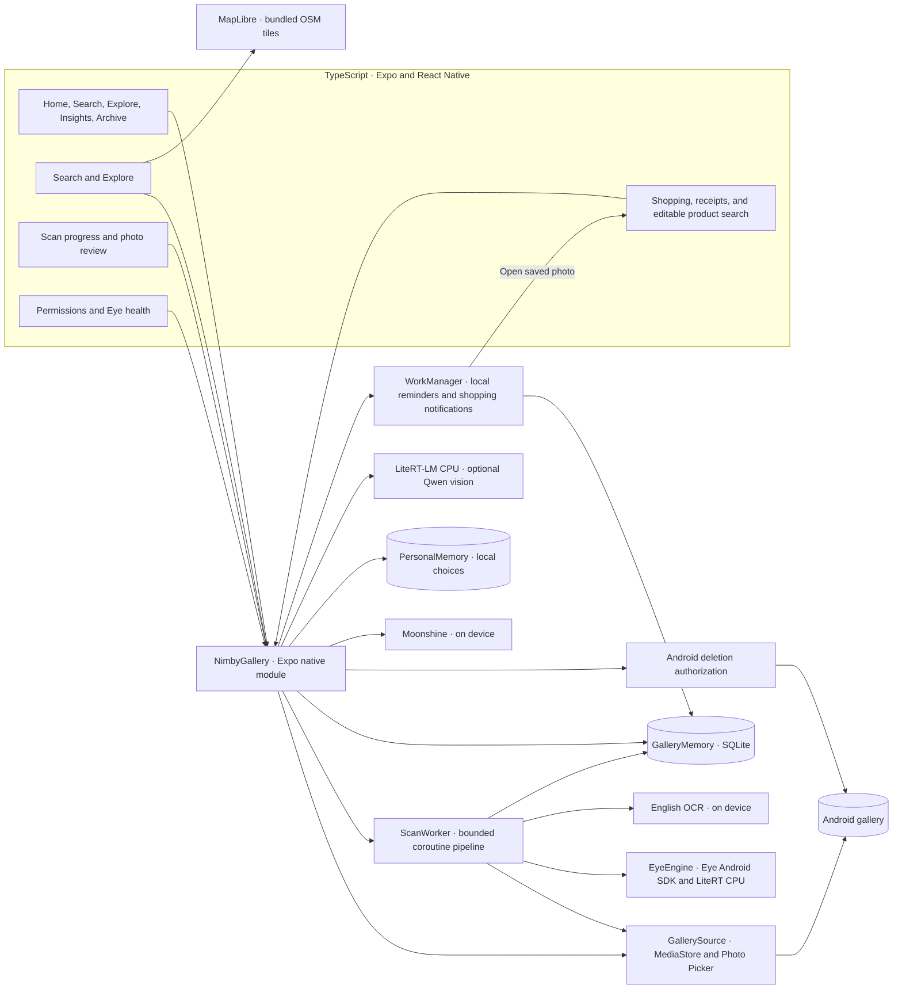
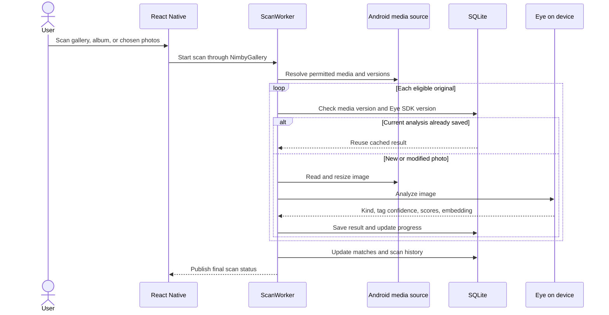
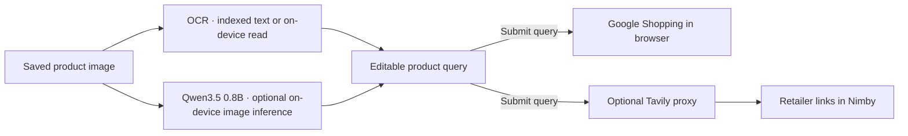

# Nimby

Nimby is an Android photo review app that helps you rediscover useful things you saved, such as receipts, whiteboards, shopping references, and screenshots. It turns a gallery scan into something you can browse and act on without sending your photos to a server.

**The difference.** A scan makes your photos searchable by what they show, what they say, and when you took them. Nimby links each result to the original photo and shows why it matched. You decide what to keep, archive, or delete.

## Find your way around

| Tab | What you can do |
| --- | --- |
| **Home** | Scan photos, see recent activity, and pick up a follow-up. |
| **Search** | Search your scanned photos by their content, text, dates, or saved places. |
| **Explore** | Open shopping and receipt follow-ups, Photo Map, Timeline, patterns, planning, and past choices. |
| **Insights** | See scan coverage, saved categories, duplicates, and estimated storage savings. |
| **Archive** | Restore photos or review eligible originals for deletion. |

## What it does

- Scan the accessible gallery, individual albums, or photos chosen through Android’s system picker.
- **Recall** finds photos by Eye scene labels, dates, saved places, or text on screenshots and documents. **Search by photo** compares a reference selected in Android’s picker with scanned photos. An optional English voice pack transcribes queries locally.
- **Photo Map** shows where you took your photos on a bundled worldwide OpenStreetMap basemap. GPS extraction from photos is opt-in. Add a place name from a photo’s actions to make it searchable.
- **Timeline and Discover** group moments and surface recurring themes from real photos. Rename, split, merge, confirm, correct, or hide suggestions.
- **Next steps and outcomes** compare actions grounded in photos you select. Saved outcomes help break ties in future Recall results and inform plan ranking.
- **Shopping and receipt follow-ups** compare up to four saved product images, prefill a product search from a screenshot, file receipts into Reimbursements, and set local reminders. Shopping suggestions appear in Nimby. Android shopping notifications are separately opt-in and batched.
- Open the results from a specific scan, including photos whose analysis was reused. Results are grouped by recognized reference category or image type, with real thumbnail previews.
- Open Revisit for up to three suggestions based on Eye’s saved results. The set favors distinct reference categories and includes at most one generic screenshot. Show a different set without dismissing photos, or browse every reference category.
- Keep photos from the viewer. Additional actions and detailed Eye confidence values are available on demand.
- Review exact file copies and visually similar photos, with a suggested keeper for each duplicate group.
- Tap duplicate thumbnails or select alternatives together to archive a batch. Change the keeper before confirming if you want to retain a different photo.
- See scan history, gallery coverage, and estimated storage impact.
- Check the Eye runtime in Settings with a bundled self-test, measured inference time, and diagnostics.

## Architecture





| Area | Implementation |
| --- | --- |
| UI | `src/` contains the React Native screens, navigation, photo grid, and viewer. |
| Android bridge | `modules/nimby-gallery/` is a local Expo module. It exposes permissions, scans, model health, review feeds, and archive operations. |
| Media | `GallerySource.kt` resolves permission-scoped MediaStore entries and system picker results. |
| Analysis | `ScanWorker.kt` manages scan progress and cache reuse. `EyeEngine.kt` prepares the model, resizes inputs, and maps Eye output into Nimby categories. |
| Shopping readers | `ReceiptOcr.kt` reads the original locally when the text index has no usable title. `ProductVision.kt` handles verified Qwen downloads and on-demand image inference. `ProductSearchSheet.tsx` lets users choose a reader and edit the query. |
| Follow-ups | `NextStepNotifications.kt` schedules local notifications through WorkManager. Tapping one opens the linked follow-up. Optional Qwen receipt review proposes a follow-up for the user to confirm. |
| Storage | `GalleryMemory.kt` owns schema migrations, Eye analysis, FTS4 text and metadata, source-specific photo locations, and the archive. Schema version 8 adds saved follow-up state and reminder due times. `PersonalMemory.kt` stores local event edits, pattern feedback, and outcomes. |
| Retailer search | `server/` provides a local Node proxy and an AWS-hosted API for Tavily. Nimby can also open Google Shopping in the browser. |
| Android host | `android/` contains the native app configuration, including Kotlin 2.4.20 and CPU-only LiteRT packaging. |

## On-device models

Nimby uses **Desert Ant Labs Eye Android SDK `4.3.0`** with the **`v1.0.0` Eye weights**. Eye’s photo analysis provides image kind, tag confidence, image-quality scores, and embeddings. Specific reference tags can take precedence over the general screenshot label. Nimby uses content hashes for exact copies and Eye outputs for visual matches. Model outputs are suggestions and can be wrong, particularly for screenshots and other images outside the model’s main photo domain. The Eye model uses a fine-tuned Meta PE-Core S/16-384 encoder. See the [Eye SDK documentation](https://desertant.com/docs/eye/) and [bundled third-party notices](modules/nimby-gallery/android/src/main/assets/eye/THIRD_PARTY_NOTICES.md).

Recall uses [Tesseract4Android](https://github.com/adaptech-cz/Tesseract4Android) with bundled English [`tessdata_fast`](https://github.com/tesseract-ocr/tessdata_fast) and SQLite FTS4. English voice uses [Moonshine Tiny Streaming](https://github.com/moonshine-ai/moonshine/blob/main/docs/models/available-models.md) on Android 8 or later. Nimby downloads the public voice pack on request, validates each file with SHA-256, then transcribes offline. Users need no Hugging Face token. Photo Map draws a bundled, low-zoom basemap with [MapLibre Native](https://maplibre.org/maplibre-native/android/examples/data/PMTiles/) and [OpenStreetMap attribution](modules/nimby-gallery/android/src/main/assets/photo-map/NOTICE.md).

**Next steps → Options → Download Qwen** installs the optional shared vision model. A Hugging Face token is unnecessary. Qwen reads selected shopping screenshots, reviews receipts, and suggests scene search terms from a reference photo. Scans, typed search, shopping comparison, and receipt reminders work without that download.

### Search by location, scene, or reference photo

- **Search → Filters → Place** uses names you saved on photos. A query like “wedding photos in Goa” uses Goa as a location filter when it’s a saved place. **Browse GPS locations on Photo Map** opens the opt-in map for photos with coordinates.
- Try visible details such as “beach”, “wedding”, or “brick wall”. Recall searches locally indexed Eye labels and recognized text.
- **Search → Search by photo** opens Android’s picker and uses one photo as a temporary visual reference. Eye compares its embedding to scanned photos. With Qwen installed, **Suggest search terms** offers scene details to use in Recall. Person matching would require a separate face-matching model.

### Follow-ups and reminders

Open **Explore → Shopping and receipt follow-ups**. Under **Shopping**, select up to four saved products to compare. Under **Receipts**, review a saved receipt, file it in **Reimbursements**, or choose a reminder time. **More actions → Review with Qwen** can suggest a follow-up when the model is installed. A return reminder suggestion requires a future deadline already read from the receipt. Shopping notifications can be enabled separately under **Options** and arrive at most once a week.

Nimby stores reminders and follow-up decisions in SQLite and uses Android WorkManager for delivery. Delivery times are approximate. A notification opens the saved photo’s follow-up in Nimby. The notification body uses generic text to keep product and receipt details private.

### Find buying links

Open **Find buying links** on a saved product. **OCR** is the default reader. Nimby uses indexed text when possible and reads the original screenshot locally when the index has no usable product title. On supported Android devices, you can switch to **Qwen vision** and download the optional 1.3 GB [Qwen3.5 0.8B vision model](https://huggingface.co/litert-community/Qwen3.5-0.8B#vision-build-qwen35-08b-vl_int8litertlm). Nimby verifies the pinned download with SHA-256 and runs inference on the CPU with LiteRT-LM 0.19.1. The Qwen panel also lets you remove the download.

Review the editable product name and model number before searching. Images and raw OCR stay on the device. The provider receives only the submitted query. Google Shopping opens in the browser without an API key.



For in-app retailer links during Android development, add these to the gitignored `.env`:

```dotenv
TAVILY_API_KEY=your-tavily-key
EXPO_PUBLIC_PRODUCT_SEARCH_URL=http://127.0.0.1:8787/product-search
```

Run `npm run product-search` in a separate terminal, then run `adb reverse tcp:8787 tcp:8787` for the connected Android target and reload Nimby through Metro. The loopback proxy keeps the API key on the host. Tavily returns candidate product pages. Verify the exact variant and availability on the retailer’s website.

For a demo with no local retailer-search server, deploy the companion [AWS API](server/product-search.aws.yaml) using AWS CLI v2, AWS SAM CLI, and a profile authorized to deploy the stack:

```sh
AWS_PROFILE=nimby bash server/deploy-product-search.sh
```

The deploy script uses `TAVILY_API_KEY` from the gitignored `.env` to create an AWS Secrets Manager secret when one doesn’t exist. The Lambda reads that credential on the server. API Gateway throttles requests and DynamoDB enforces a shared daily search limit. Set `EXPO_PUBLIC_PRODUCT_SEARCH_URL` in `.env` to the printed HTTPS endpoint and restart Metro or rebuild for distribution. The [Amplify landing page](landing/README.md) is deployed separately.

## Run on Android

Use Node.js 22.18 or later, JDK 17, Android Studio, and the Android SDK. Use an `arm64-v8a` or `x86_64` device or emulator running Android 7 or later. Set `ANDROID_HOME` or create a local `android/local.properties` with your SDK path. Check that `adb devices` lists your target.

The Android build pins Kotlin 2.4.20, which has matching Expo compiler plugins and reads the Kotlin 2.4 metadata in LiteRT-LM 0.19.1. Gradle installs the compiler as part of the build.

1. Download `eye.tflite` and `eye_meta.json` from the [official Eye v1.0.0 release](https://huggingface.co/desert-ant-labs/eye/tree/v1.0.0), review the upstream terms, and place both files in `modules/nimby-gallery/android/src/main/assets/eye/`. They are packaged into the app at build time. Each clone obtains these separately from the model publisher.
2. Generate a local Android debug key once if `android/app/debug.keystore` is absent. That file is for local builds and stays out of Git.
3. Install dependencies and run the app.

```sh
keytool -genkeypair -keystore android/app/debug.keystore -storepass android \
  -alias androiddebugkey -keypass android -keyalg RSA -keysize 2048 \
  -validity 10000 -dname "CN=Android Debug,O=Android,C=US"
npm ci
npm run android
```

Gradle resolves the Android SDK dependency from Maven Central. The app stages the packaged model in its private directory and inference runs on the device. In **Settings → Run Self-Test**, Nimby can verify the runtime with a bundled image. Depending on your current installation, a different debug key may require using a separate emulator or uninstalling the old build, which removes its app data.

## Privacy, archive, and storage

- Full, selected-only, and denied photo access are presented according to Android’s permissions. Manual picking uses Android’s picker.
- Photo analysis and keep or dismiss decisions stay in app-local SQLite. Event corrections and outcomes also stay on-device. Originals remain in the gallery.
- Photo locations are off by default. Enable them on Photo Map, and use **Clear photo locations** to remove the stored coordinates. Map tiles, labels, and photo clusters are local.
- Microphone access is requested when starting a voice search. Nimby keeps recordings in memory while transcribing. Typed Recall works without the voice pack.
- Archiving hides a photo in Nimby while its original remains in the gallery. Restore removes the archive record.
- After 30 days an item can be reviewed for deletion. Deletion is never automatic. On Android 11 and later, deletion requires an explicit in-app review, Android confirmation, and an unchanged, accessible MediaStore original.
- Potential savings are estimates. Nimby records original file bytes as deleted only after Android approves the operation and absence is verified. Android’s free-space figure can differ from this estimate.

## Verification

```sh
npm run typecheck
python3 tests/storage_smoke.py
python3 tests/memory_smoke.py
python3 tests/next_step_storage_smoke.py
python3 tests/photo_map_asset_smoke.py
node --test tests/*.test.mjs
kotlinc modules/nimby-gallery/android/src/main/java/dev/nimby/gallery/DuplicateGrouping.kt \
  tests/DuplicateGroupingSmoke.kt -include-runtime -d /tmp/nimby-duplicates.jar
java -jar /tmp/nimby-duplicates.jar
```

On a device, run the Eye self-test, scan an album twice to verify cache reuse, and exercise permission changes from Android settings. Archive and restore a photo, then check that the original remains in the system gallery. Use expendable test files for deletion checks.

For shopping, open a screenshot whose product and model number you know. Check OCR autofill, then opt into Qwen and compare its suggestion. Edit the query before submitting it. Test Google Shopping and, if configured, the Tavily proxy. Low-memory devices can use OCR and manual entry. Verify a local reminder opens the intended photo’s follow-up.

For scan review, scan two albums separately and open each result from Settings → Scan history. Check that each shows its own categories and photos, including cached results on a repeat scan. Scan records created before the results feature retain their counts and dates. Their per-photo membership becomes available when you run a new scan.
