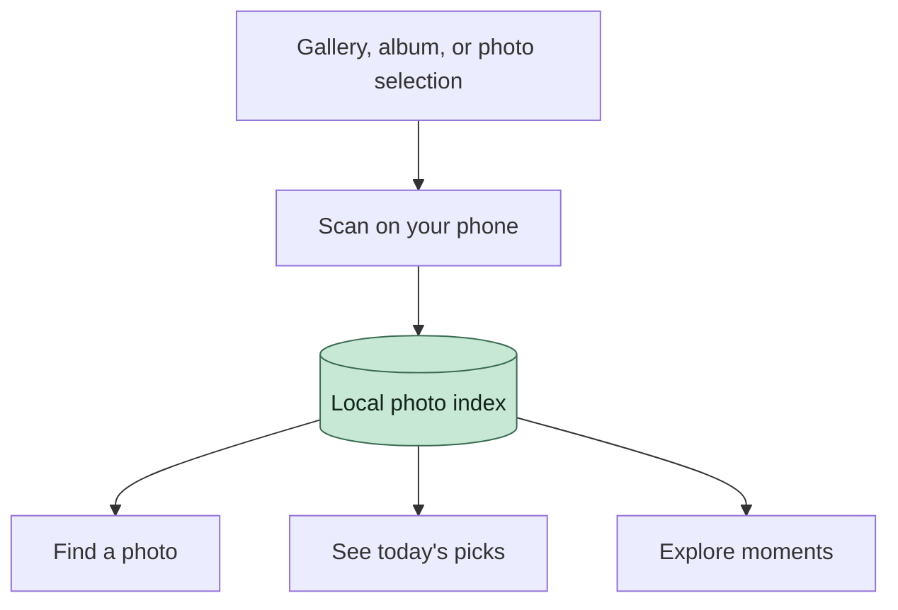
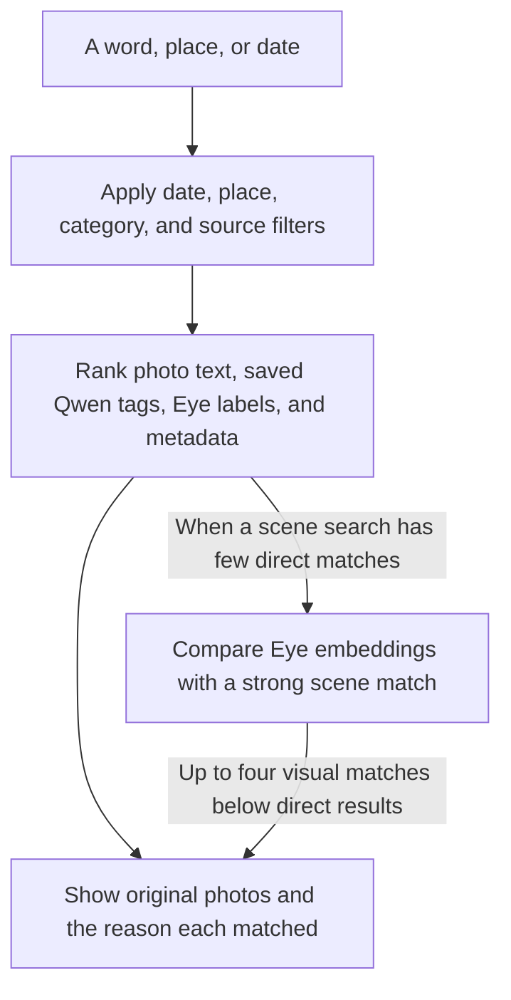
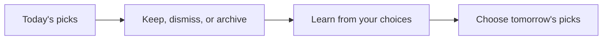
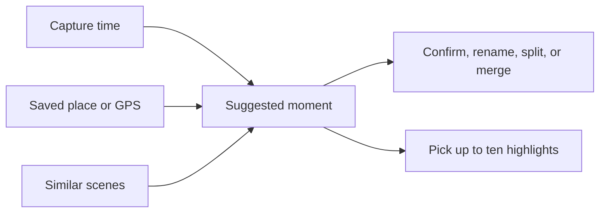
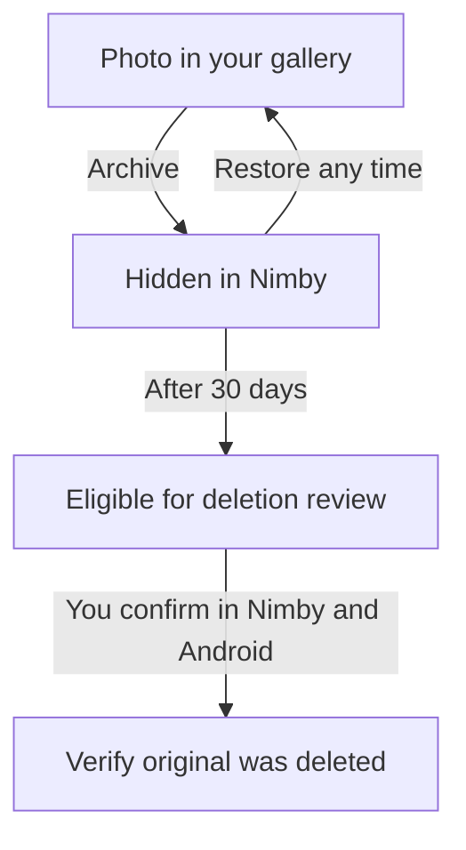
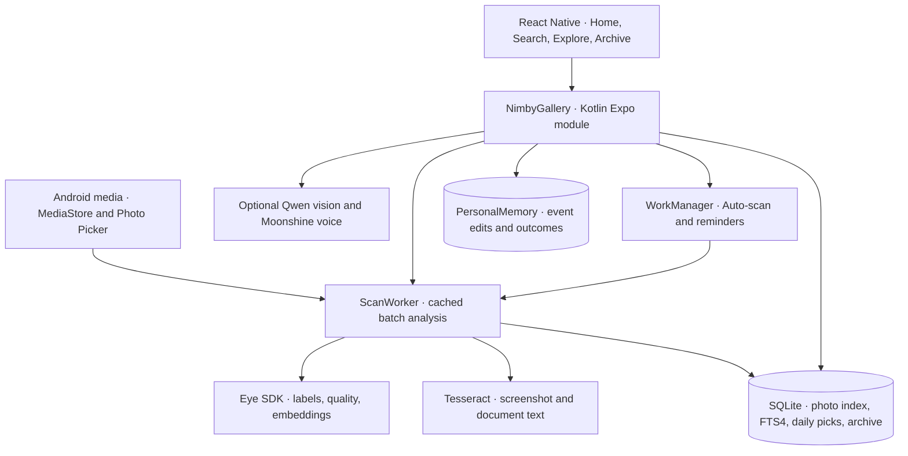
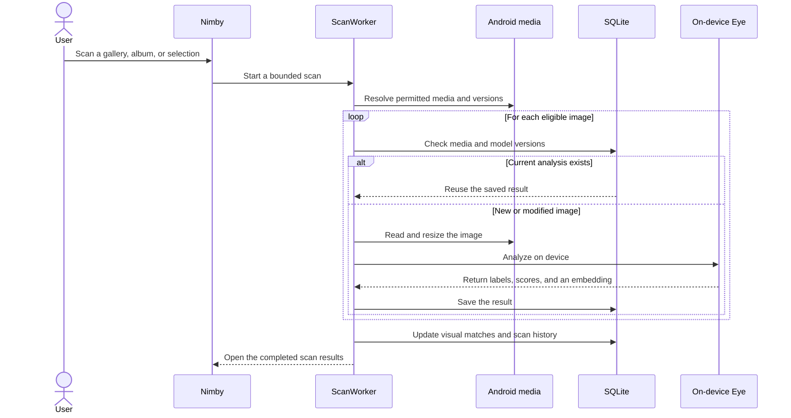

# Nimby


**Find the things you saved.** The receipt you need to file, the whiteboard from a meeting, or the photo from that trip in January. Nimby makes your Android gallery searchable on your phone and shows you why a photo matched.

[Take a tour](#take-a-tour) · [Run on Android](#run-on-android) · [Architecture](#architecture) · [Privacy and archive](#privacy-and-archive)

## Take a tour

Start with a folder of screenshots, a trip album, or a few photos from Android’s picker. Nimby analyzes the originals you can access and reuses its work on later scans. The results open as soon as the scan finishes.



### Search with what you remember

| If you remember… | Try this in Search |
| --- | --- |
| A word or model number from a screenshot | Type it and look for the **Photo text** snippet. |
| When and where you took the photo | Try `Singapore Jan` or combine a place and date in **Filters**. Add a year to narrow it down. |
| What a scene looked like | Try `beach` or `brick wall`. Look for the matching Eye label or saved Qwen tag below the photo. |
| Another photo that looks like it | Tap **Search by photo**. Eye compares scenes, layouts, and styles. |

Saved place names are searchable as soon as you add them. Enable **Photo Map** locations to match supported city names against GPS and see your photos on the offline map.



Exact photo text takes priority. Visual matches show the tag that led to the suggestion. You can also download an optional English voice pack from Search and speak a query offline. With Qwen installed, open **More photo actions → Search tags** to review and save extra tags for a photo.

### See what’s worth revisiting today

**Home → Daily discoveries** brings back up to three photos or saved references. The set stays put for the day and favors photos from outside recent sets. Each pick has a short reason. Keep, dismiss, or archive from the photo viewer, or browse more by category when you’re done.



### Put an outing back together

Open **Explore → Timeline** to see suggested moments. Nimby combines when and where photos were taken with existing Eye scene embeddings. Confirm a moment, rename it, or split and merge suggestions to fit what you remember. **Pick highlights** chooses up to ten photos for that moment, skips screenshots and documents, and favors one frame from each detected burst.



### Get something done with a saved screenshot

Under **Explore → Shopping & receipts**, compare up to four shopping screenshots, look up a product, file a receipt into **Reimbursements**, or set a reminder. **Review with Qwen** can suggest a receipt follow-up. You approve the action and choose the date. Shopping notifications are opt-in and arrive at most once a week.

**Find buying links** prefills an editable query using local OCR or optional Qwen vision. When hosted search is enabled on the landing site, Nimby can show retailer candidates directly. Google Shopping is also available in the browser. The provider receives the text you submit. Your screenshot stays on your phone.

| Also in Nimby | Where to look |
| --- | --- |
| Review exact copies and similar photos, choose a keeper, and archive the rest | **Home → Duplicates** |
| See photos by place on a bundled OpenStreetMap basemap | **Explore → See where photos were taken** |
| Review recurring themes, compare next steps, and record what worked | **Explore → More to explore** |
| Check scan coverage, categories, and estimated storage savings | **Home → View gallery insights** |
| Check photo permissions, Auto-scan, and the Eye self-test | **Settings** |

## Privacy and archive

Nimby runs photo analysis, OCR, voice transcription, and retrieval on your phone. Android controls access to your full or selected library. You can also pick individual photos. GPS indexing is opt-in and **Clear photo locations** removes stored coordinates.

Archiving hides a photo within Nimby and leaves the original in the gallery. Restore it whenever you like. After 30 days it becomes eligible for a separate deletion review. Deletion requires your in-app approval and Android authorization on Android 11 or later. Nimby records deleted file bytes only after it verifies the original is gone.



## Run on Android

Use **Node.js 22.18 or later**, **JDK 17**, Android Studio, and the Android SDK. Nimby runs on Android 7 or later on `arm64-v8a` or `x86_64`.

1. Set `ANDROID_HOME` or put your SDK path in `android/local.properties`. Connect a device or start an emulator and check `adb devices`.
2. Get `eye.tflite` and `eye_meta.json` from the Eye v1.0.0 release. Review the upstream terms and put both files in `modules/nimby-gallery/android/src/main/assets/eye/`. Gradle packages them with Nimby. [Eye model release](https://huggingface.co/desert-ant-labs/eye/tree/v1.0.0)
3. If `android/app/debug.keystore` is missing, create a local signing key. Keep using the same key for future installs so Android can preserve your app data.

```sh
keytool -genkeypair -keystore android/app/debug.keystore -storepass android \
  -alias androiddebugkey -keypass android -keyalg RSA -keysize 2048 \
  -validity 10000 -dname "CN=Android Debug,O=Android,C=US"
```

```sh
npm ci
npm run android
```

Open **Settings → On-device models → Run Self-Test** to check the bundled Eye runtime and see its inference time.

### Take it for a demo without Metro

Run `npm run android:demo` with your phone connected, then open Nimby from the Android launcher. This installs a local release with the JavaScript embedded.

Scan a small album with a few screenshots and dated photos. Search for a word you can see in a screenshot, point out the **Photo text** evidence, and tap **Keep**. Open **Daily discoveries** for a pick and **Timeline** for a suggested moment. To demo Qwen, download it ahead of time and check for **Ready** in Explore.

### Auto-scan

After your first scan, enable **Settings → Photo access → Auto-scan**. Choose daily or weekly and optionally restrict checks to charging. Android chooses when to run based on device conditions. Nimby checks up to 24 candidate photos per batch, skipping unchanged analyses, archived originals, and excluded albums. Settings shows the last check and its result. Clearing analysis turns Auto-scan off.

## Architecture

The React Native app calls a local Expo module in Kotlin. The scan worker analyzes resized images from Android’s media sources and saves reusable results to SQLite. The app uses that same index to search, recommend picks, build moments, and review duplicates.



<details>
<summary>Follow a scan through the worker</summary>



</details>

| What runs locally | What it powers |
| --- | --- |
| **Desert Ant Labs Eye Android SDK `4.3.0`** with **v1.0.0 weights** | Classification, quality scores, visual similarity, and Timeline. Exact-copy detection uses file hashes. [Eye documentation](https://desertant.com/docs/eye/) · [Model notices](modules/nimby-gallery/android/src/main/assets/eye/THIRD_PARTY_NOTICES.md) |
| **SQLite and FTS4** | Gallery metadata, OCR text, saved Qwen tags, search, archives, and stored daily picks. Schema v10 normalizes earlier embeddings and v11 adds daily picks and decision timestamps. |
| **Tesseract4Android** with bundled English data | OCR for text search and the default product reader. [Tesseract4Android](https://github.com/adaptech-cz/Tesseract4Android) · [Tessdata](https://github.com/tesseract-ocr/tessdata_fast) |
| **Qwen3.5 0.8B vision**, optional **1.3 GB** download | Product names, receipt follow-up suggestions, and reviewed search tags. LiteRT-LM 0.19.1 runs the model on CPU after verifying the download with SHA-256. [Model card](https://huggingface.co/litert-community/Qwen3.5-0.8B#vision-build-qwen35-08b-vl_int8litertlm) |
| **Moonshine Tiny Streaming**, optional English voice pack | On-device transcription on Android 8 and later. [Moonshine models](https://github.com/moonshine-ai/moonshine/blob/main/docs/models/available-models.md) |
| **MapLibre** and bundled map data | Offline Photo Map with OpenStreetMap attribution. [Map data notices](modules/nimby-gallery/android/src/main/assets/photo-map/NOTICE.md) |

Core scans and typed search work before any optional download. Get Qwen from **Explore** or **Settings → On-device models**. Public model downloads require no Hugging Face token. The Android build pins Kotlin 2.4.20 for Expo and LiteRT-LM compatibility.

### Find buying links

Released builds read `product-search.json` from the production landing site to discover the hosted retailer endpoint. The website serves public configuration, and the AWS API handles the search and reads the Tavily key from Secrets Manager. When the endpoint is unavailable, users can still open Google Shopping.

With AWS CLI v2 and AWS SAM CLI installed, put `TAVILY_API_KEY` in the gitignored root `.env` and deploy the API and landing page together.

```sh
AWS_PROFILE=nimby NIMBY_AMPLIFY_APP_ID=d3ulvfvvudr0cr NIMBY_DEPLOY_PRODUCT_SEARCH=1 ./landing/deploy-aws.sh
```

The command checks the API before publishing the landing configuration. API Gateway throttles requests, and DynamoDB enforces the shared daily search limit. Future landing deploys can reuse the same stack. Installed builds that support the landing configuration pick up endpoint changes the next time the search sheet opens. [API template](server/product-search.aws.yaml) · [Landing setup](landing/README.md)

<details>
<summary>Use a local proxy for development</summary>

If you specifically want to test the loopback proxy, set these variables in the gitignored root `.env`.

```dotenv
TAVILY_API_KEY=your-tavily-key
EXPO_PUBLIC_PRODUCT_SEARCH_URL=http://127.0.0.1:8787/product-search
```

Run `npm run product-search` in a second terminal and connect your Android target.

```sh
adb reverse tcp:8787 tcp:8787
```

Reload from Metro after changing the override. The proxy keeps the API key on the host. Release builds ignore loopback overrides and use the hosted configuration. An explicit HTTPS `EXPO_PUBLIC_PRODUCT_SEARCH_URL` can override discovery for a separate environment.

</details>

## Verification

```sh
npm run typecheck
node --test tests/*.test.mjs
python3 tests/storage_smoke.py
python3 tests/memory_smoke.py
python3 tests/next_step_storage_smoke.py
python3 tests/photo_map_asset_smoke.py
```

<details>
<summary>Native scoring and on-device checks</summary>

```sh
kotlinc modules/nimby-gallery/android/src/main/java/dev/nimby/gallery/DuplicateGrouping.kt \
  tests/DuplicateGroupingSmoke.kt -include-runtime -d /tmp/nimby-duplicates.jar
java -jar /tmp/nimby-duplicates.jar

kotlinc modules/nimby-gallery/android/src/main/java/dev/nimby/gallery/VisualEmbeddings.kt \
  tests/VisualEmbeddingsSmoke.kt -include-runtime -d /tmp/nimby-visual-embeddings.jar
java -jar /tmp/nimby-visual-embeddings.jar

kotlinc modules/nimby-gallery/android/src/main/java/dev/nimby/gallery/{DailyDiscovery,TimelineScenes,VisualEmbeddings}.kt \
  tests/PersonalDiscoverySmoke.kt -include-runtime -d /tmp/nimby-discovery.jar
java -jar /tmp/nimby-discovery.jar
```

- Run the Eye self-test, then scan the same album twice to check that analysis is reused. Open the results from each run under **Settings → Library status → Scan history**. Older records gain per-photo results after a new scan.
- Change photo access in Android and check that Nimby reflects it. Archive and restore a photo, then verify it remains in the system gallery. Use expendable files for deletion checks.
- Force-stop Nimby, reopen it, and run **Find Similar** twice on the same photo. `adb logcat -s NimbySearch:D` shows cache hits and lookup time. The Float32 cache holds up to 4,096 vectors (8 MiB) or 1,024 on low-RAM devices (2 MiB). The timings exclude reference-image inference.
- Check OCR and Qwen autofill on a screenshot with a known product name. Submit an edited query and verify that a local reminder opens the correct follow-up.

</details>
