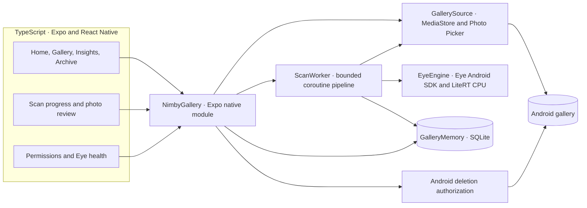
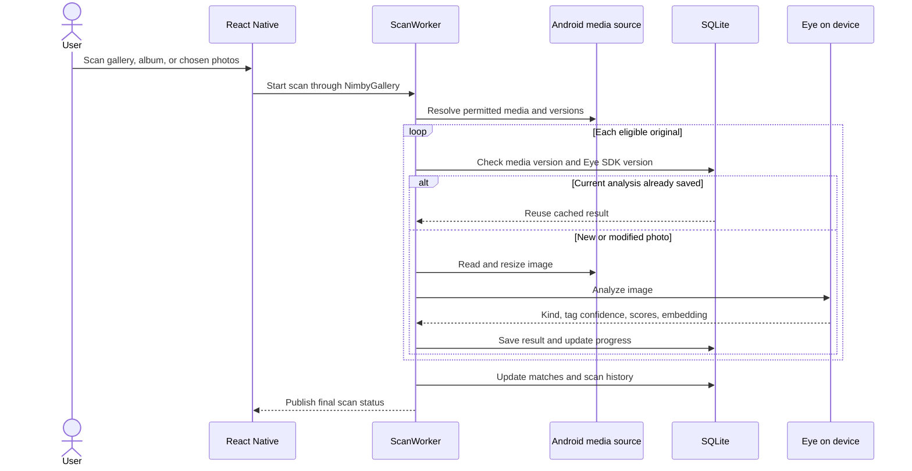

# Nimby

Nimby is an Android photo review app that helps you rediscover useful things you saved, such as receipts, whiteboards, shopping references, and screenshots. It turns a gallery scan into something you can browse and act on without sending your photos to a server.

**The difference:** Nimby combines a searchable-by-category local index, duplicate review, and a reversible archive. Photos stay in your gallery. Eye processes them on your device, and Nimby leaves keep, archive, and deletion decisions to you.

## What it does

- Scan the accessible gallery, individual albums, or photos chosen through Android’s system picker.
- Revisit references by the categories recognized from Eye’s photo classification. Keep, dismiss, or organize a photo into a collection.
- Review exact file copies and visually similar photos, with a suggested keeper for each duplicate group.
- See scan history, gallery coverage, and estimated storage impact.
- Check the Eye runtime in Settings with a bundled self-test, measured inference time, and diagnostics.

## Architecture





| Area | Implementation |
| --- | --- |
| UI | `src/` contains the React Native screens, navigation, photo grid, and viewer. |
| Android bridge | `modules/nimby-gallery/` is a local Expo module. It exposes permissions, scans, model health, review feeds, and archive operations. |
| Media | `GallerySource.kt` resolves permission-scoped MediaStore entries and system picker results. |
| Analysis | `ScanWorker.kt` manages scan progress and cache reuse. `EyeEngine.kt` prepares the model, resizes inputs, and maps Eye output into Nimby categories. |
| Storage | `GalleryMemory.kt` owns schema migrations, analysis records, user decisions, scan history, the archive, and deletion receipts. `DuplicateGrouping.kt` implements exact and approximate grouping. |
| Android host | `android/` contains the native app configuration, including CPU-only LiteRT packaging. |

## Model

Nimby uses **Desert Ant Labs Eye Android SDK `4.3.0`** with the **`v1.0.0` Eye weights**. Eye’s photo analysis provides image kind, tag confidence, image-quality scores, and embeddings. Specific reference tags can take precedence over the general screenshot label. Nimby uses content hashes for exact copies and Eye outputs for visual matches. Model outputs are suggestions and can be wrong, particularly for screenshots and other images outside the model’s main photo domain. The Eye model uses a fine-tuned Meta PE-Core S/16-384 encoder. See the [Eye SDK documentation](https://desertant.com/docs/eye/) and [bundled third-party notices](modules/nimby-gallery/android/src/main/assets/eye/THIRD_PARTY_NOTICES.md).

## Run on Android

Use Node.js, JDK 17, Android Studio and the Android SDK. Use an `arm64-v8a` or `x86_64` device or emulator running Android 7 or later. Set `ANDROID_HOME` or create a local `android/local.properties` with your SDK path. Check that `adb devices` lists your target.

1. Download `eye.tflite` and `eye_meta.json` from the [official Eye v1.0.0 release](https://huggingface.co/desert-ant-labs/eye/tree/v1.0.0), review the upstream terms, and place both files in `modules/nimby-gallery/android/src/main/assets/eye/`. They are packaged into the app at build time. Each clone obtains these separately from the model publisher.
2. Generate a local Android debug key once if `android/app/debug.keystore` is absent. That file is for local builds and stays out of Git.
3. Install dependencies and run the app.

```sh
keytool -genkeypair -keystore android/app/debug.keystore -storepass android \
  -alias androiddebugkey -keypass android -keyalg RSA -keysize 2048 \
  -validity 10000 -dname "CN=Android Debug,O=Android,C=US"
npm ci
npm run android
```

Gradle resolves the Android SDK dependency from Maven Central. The app stages the packaged model in its private directory and inference runs on the device. In **Settings → Run Self-Test**, Nimby can verify the runtime with a bundled image. Depending on your current installation, a different debug key may require using a separate emulator or uninstalling the old build, which removes its app data.

## Privacy, archive, and storage

- Full, selected-only, and denied photo access are presented according to Android’s permissions. Manual picking uses Android’s picker.
- Analysis and user decisions stay in app-local SQLite. Nimby does not upload the gallery or make an app-private copy of every original.
- Archiving hides a photo in Nimby while its original remains in the gallery. Restore removes the archive record.
- After 30 days an item can be reviewed for deletion. Deletion is never automatic. On Android 11 and later, deletion requires an explicit in-app review, Android confirmation, and an unchanged, accessible MediaStore original.
- Potential savings are estimates. Nimby records original file bytes as deleted only after Android approves the operation and absence is verified. Android’s free-space figure can differ from this estimate.

## Verification

```sh
npm run typecheck
python3 tests/storage_smoke.py
kotlinc modules/nimby-gallery/android/src/main/java/dev/nimby/gallery/DuplicateGrouping.kt \
  tests/DuplicateGroupingSmoke.kt -include-runtime -d /tmp/nimby-duplicates.jar
java -jar /tmp/nimby-duplicates.jar
```

On a device, run the Eye self-test, scan an album twice to verify cache reuse, and exercise permission changes from Android settings. Archive and restore a photo, then check that the original remains in the system gallery. Use expendable test files for deletion checks.
