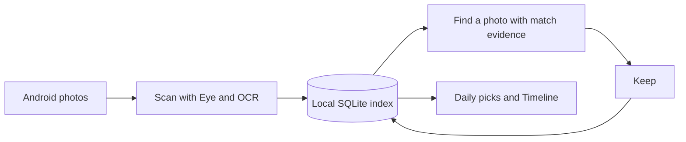

# Nimby


**Your phone. Your agent.**

Your camera roll has become a junk drawer. The receipt you need, the product screenshot you saved, and the photos from your last trip are all in there somewhere.

Nimby turns your Android gallery into searchable memory. Desert Ant Labs Eye understands what’s in a photo. Local OCR reads the words. Search brings back the original photo and shows why it matched. The analysis happens on your phone.

[](https://production.d3ulvfvvudr0cr.amplifyapp.com/)

[Early signal](#early-signal) · [Architecture](#architecture) · [Run on Android](#run-on-android)

## From gallery search to personal intelligence

**Recall → Discover → Decide → Evolve**

Search gets you back to the thing you saved. Daily discoveries bring useful older photos back into view. Timeline groups related shots and can pick highlights from a trip. In **Shopping & receipts**, optional on-device Qwen Vision helps identify products and suggest receipt follow-ups. Your decisions give future suggestions more context.

Next, we’re hardening search on real galleries, moving web license unlocks toward production, and making daily discoveries worth coming back for.

## Early signal

A friends-and-family share brought **38 landing-page visits and 27 waitlist signups** (~71%). **21 of the signups said they’d pay.** Interest spanned limited free access, ₹199/month, and ₹1,999 lifetime.

We’re exploring Free, Plus, and Lifetime. The preview has a sandbox web checkout and license-key flow. Privacy controls and Archive are available without a license. [Landing and checkout setup](landing/README.md)

## Architecture



Expo and React Native handle the UI. A Kotlin worker reads photos through Android’s media APIs, uses Eye SDK 4.3.0 for categories and visual similarity, and uses Tesseract for text. SQLite and FTS4 store the searchable results and user decisions so later scans can reuse previous work.

**Qwen3.5 0.8B Vision** is an optional 1.3 GB model for image details, search tags, and follow-ups. The checkout demo uses an already installed copy. An optional Moonshine pack adds English voice search. Scanning and typed search work with the bundled models.

## Privacy and archive

Android controls which photos Nimby can read. Photo analysis, text recognition, and search run on the phone. Photo Map location access is opt-in. **Find buying links** sends the product text you approve to a retailer search provider.

Archive hides photos within Nimby and leaves the originals in your gallery. You can restore them at any time. After 30 days they become eligible for deletion review. On Android 11 and later, deleting an original requires separate in-app confirmation and Android authorization.

Read the Privacy Policy and Terms & Conditions in **Settings → Legal**, or contact **reach@getnimby.com**.

## Run on Android

Nimby’s sideload preview is **`v0.0.1`**. Use Android 7 or later on an `arm64-v8a` or `x86_64` device.

To build from source, use Node.js 22.18+, JDK 17, and the Android SDK.

1. Set `ANDROID_HOME` or add the SDK path to `android/local.properties`. Connect a device or emulator and check `adb devices`.
2. Put `eye.tflite` and `eye_meta.json` in `modules/nimby-gallery/android/src/main/assets/eye/`. [Eye v1.0.0 weights and terms](https://huggingface.co/desert-ant-labs/eye/tree/v1.0.0)
3. If `android/app/debug.keystore` is missing, create it with the command below. Reuse the same key for sideload updates.

```sh
keytool -genkeypair -keystore android/app/debug.keystore -storepass android \
  -alias androiddebugkey -keypass android -keyalg RSA -keysize 2048 \
  -validity 10000 -dname "CN=Android Debug,O=Android,C=US"
```

```sh
npm ci
npm run android
```

For the standalone preview, run `npm run android:demo` to build and install **`android/app/build/outputs/apk/release/nimby-v0.0.1.apk`**. Open **Settings → On-device models → Eye → Run Self-Test** to check the bundled model.

### Find buying links

Released builds read `product-search.json` from the landing site to find the hosted endpoint. The Tavily key lives on the server. Google Shopping is available in the browser if the endpoint is unavailable. [Deployment and configuration](landing/README.md#deploy-with-retailer-search)

For local development, set `TAVILY_API_KEY` and `EXPO_PUBLIC_PRODUCT_SEARCH_URL=http://127.0.0.1:8787/product-search` in the gitignored `.env`, run `npm run product-search`, and use `adb reverse tcp:8787 tcp:8787`.

### Development checks

```sh
npm run typecheck
node --test tests/*.test.mjs
```


